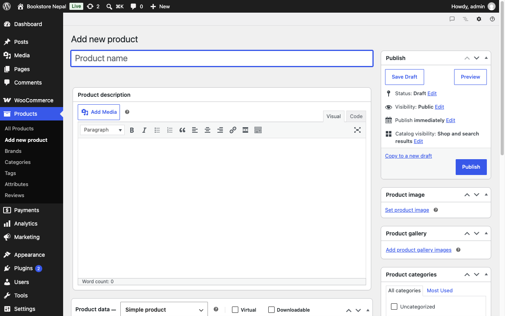
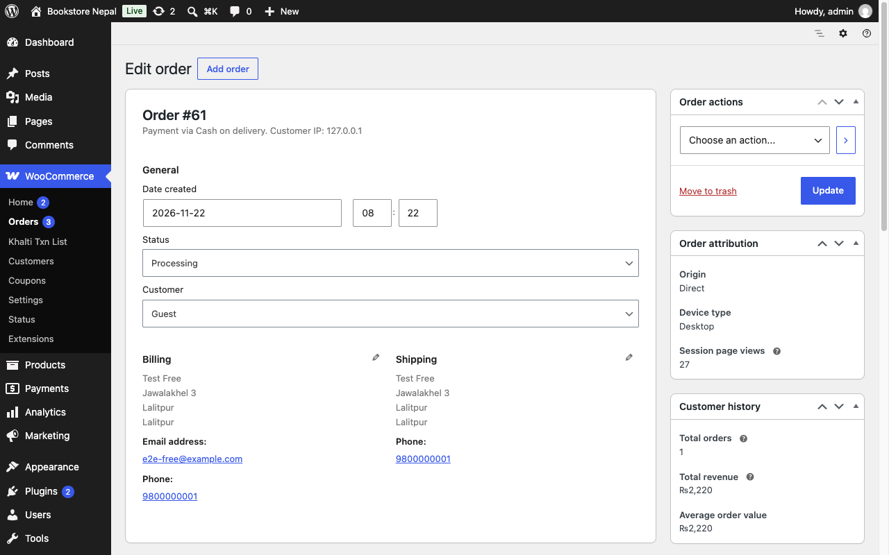
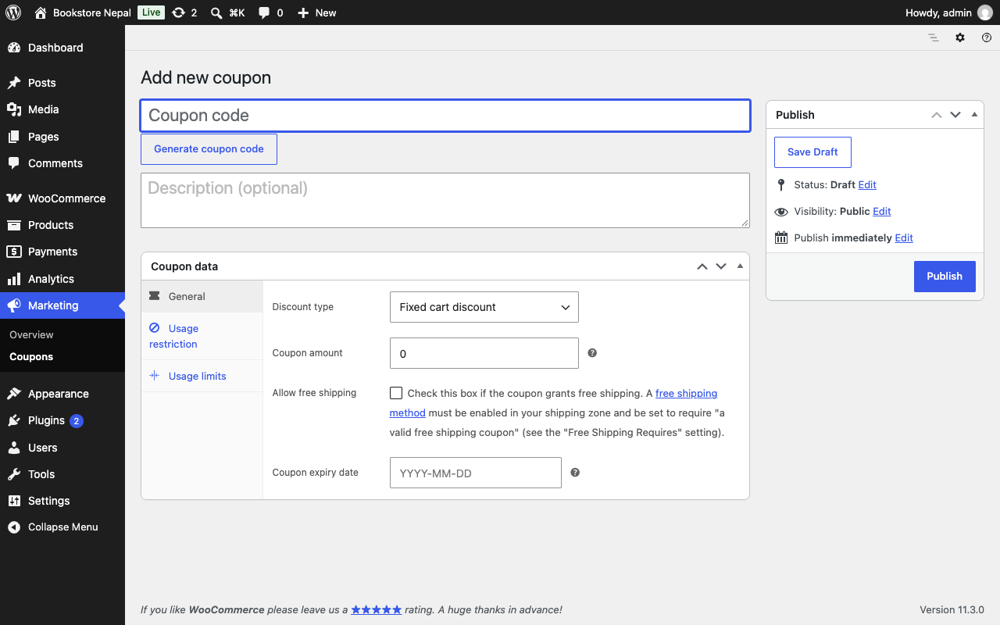

# Shop admin guide

This guide shows you how to run your online bookstore day to day. You do everything in the shop's admin area (called wp-admin). Log in at `https://your-shop-address/wp-admin` with the username and password we gave you.

The menu is on the left side of every admin page. Menu paths in this guide are written like **Products › Add new product**, which means: click **Products**, then click **Add new product**.

Contents:

1. [Add a book](#1-add-a-book)
2. [Change a price or put a book on sale](#2-change-a-price-or-put-a-book-on-sale)
3. [Update stock](#3-update-stock)
4. [Process an order](#4-process-an-order)
5. [Create a discount code](#5-create-a-discount-code)
6. [Change the featured books on the home page](#6-change-the-featured-books-on-the-home-page)
7. [Change delivery rates](#7-change-delivery-rates)

---

## 1. Add a book

1. Go to **Products › Add new product**.
2. Type the book's title at the top, and a description in the large box below it. The description is shown on the book's page.
3. In the **Product data** box, on the **General** tab, fill in:
   - **Regular price (Rs)**: the price in rupees, for example `450`.
   - **Author** and **Page count**: shown on the book's page.
4. Click the **Inventory** tab. Tick **Track stock quantity for this product**, then enter the **Quantity** you have. Optionally enter an **SKU** (your own code for the book, or the ISBN).
5. Click the **Attributes** tab. This is how customers find the book when they browse by age, language and type. For each of **Age group**, **Language** and **Book type**:
   1. Choose it from the **Add existing** drop-down (the list is on the Attributes tab).
   2. Click in the **Value(s)** box and choose one or more values (for example Age group: `4–7`; Language: `Nepali`; Book type: `Story`).
   3. Click **Save attributes**.
6. On the right, click **Set product image** and upload the cover photo. Use **Add product gallery images** for extra photos (back cover, inside pages).
7. Under **Product categories**, tick a category if you use them.
8. Click **Publish**. The book now appears in the shop.

Tip: to add a book that is similar to an existing one, go to **Products › All Products**, hover over the book's name until the links appear under it, and click **Duplicate**, then change the details.

## 2. Change a price or put a book on sale

1. Go to **Products › All Products**.
2. Find the book (use the search box at the top right) and click its name.
3. On the **General** tab of the **Product data** box:
   - To change the normal price, edit **Regular price (Rs)**.
   - To put the book on sale, type the discounted price into **Sale price (Rs)**. Customers see the old price crossed out and the sale price next to it.
   - To run the sale only for certain dates, click **Schedule** under the sale price and choose the start and end dates.
   - To end a sale, empty the **Sale price (Rs)** box.
4. Click **Update**.

## 3. Update stock

When new copies arrive, or when you sell books outside the website:

1. Go to **Products › All Products**. The **Stock** column shows how many copies are left for every book.
2. Click the book's name, then the **Inventory** tab in the **Product data** box.
3. Change **Quantity**.
4. Click **Update**.

What the shop does for you:

- When a customer orders a book, the quantity goes down automatically.
- When a book reaches 0, it shows as **Out of stock** and cannot be bought.
- When a book is down to 3 copies or fewer, the shop emails the admin address so you can re-order in time.
- To stop selling a book without deleting it, set **Stock status** to **Out of stock** on the Inventory tab.

## 4. Process an order

When a customer places an order, you receive an email, and the order appears under **WooCommerce › Orders**. An order moves through these statuses:

| Status | Meaning |
| --- | --- |
| **Pending payment** | Customer chose eSewa but has not finished paying yet. Do not pack it. |
| **Processing** | The order is confirmed (paid by eSewa, or cash on delivery). Time to pack it. |
| **Packed** | The books are packed and ready for the courier. |
| **Shipped** | Handed to the courier or rider. |
| **Delivered** | The customer has received the books. |
| **On hold** | Needs your attention before going on. |
| **Cancelled** / **Refunded** / **Failed** | Order did not go ahead. |

Step by step:

1. Go to **WooCommerce › Orders** and click an order to open it. You see the customer's name, phone number, delivery address and the books ordered. The payment method is shown under the order number, for example "Payment via Cash on delivery".
2. Pack the books. Then change the status:
   1. In the **Status** drop-down under **General** (at the top of the order), choose **Packed**.
   2. Click the blue **Update** button at the top right, in the **Order actions** box.
3. When the courier takes the parcel, set the status to **Shipped** and click **Update**.
4. When the customer has received it, set the status to **Delivered** and click **Update**.

The customer gets an email when the order is first confirmed and when it is marked **Delivered**.

To change many orders at once: on the **WooCommerce › Orders** list, tick the orders, choose **Change status to packed**, **Change status to shipped** or **Change status to completed** from **Bulk actions**, and click **Apply**. ("Completed" is the same as **Delivered**; the bulk menu uses WooCommerce's original name for it.)

**Cash on delivery (COD) orders.** The customer pays the rider when the books arrive, so a COD order shows as **Processing** from the start, even though no money has been received. Pack and ship it as normal. When the rider confirms the cash was collected and the books were handed over, set the order to **Delivered**. That is how you confirm payment for a COD order. If the customer refuses the parcel, set it to **Cancelled**, and the books go back into stock.

**eSewa orders.** The order moves to **Processing** by itself once eSewa confirms the payment. If a customer started paying but never finished, the order stays on **Pending payment**. You can ignore it. The customer can also place a new order and choose cash on delivery instead.

**Customers can track their order** on the "Track your order" page of the website, using their order number and email.

## 5. Create a discount code

1. Go to **WooCommerce › Coupons** and click **Add coupon**.
2. In **Coupon code** type the code customers will enter (for example `EID10`). Optionally add a description for yourself.
3. On the **General** tab:
   - **Discount type**: choose **Percentage discount** (for example 10%) or **Fixed cart discount** (for example Rs 100 off the whole order).
   - **Coupon amount**: the percentage or rupee amount.
   - **Coupon expiry date**: when the code stops working (optional but recommended).
4. On the **Usage restriction** tab you can set a **Minimum spend** for the code to work.
   (The tabs are **General**, **Usage restriction** and **Usage limits**.)
5. On the **Usage limits** tab you can limit how many times the code can be used in total (**Usage limit per coupon**) and by each customer (**Usage limit per user**).
6. Click **Publish**.

Customers enter the code in the cart or at checkout. To stop a code, open it in **WooCommerce › Coupons** and move it to the trash, or set an expiry date in the past.

## 6. Change the featured books on the home page

The home page has a section called **Our favourites** that shows books you have marked as featured (starred). It shows up to eight. The **New arrivals** section next to it fills in automatically with your newest books; you do not need to manage that one.

1. Go to **Products › All Products**.
2. Look at the star column (the column with a star at the top). A filled blue star means the book is featured. An empty star means it is not.
3. Click a star to switch it on or off. The change is saved straight away.

If more than eight books are starred, the home page shows the newest eight of them.

## 7. Change delivery rates

Delivery has two prices, depending on where the customer lives:

- **Kathmandu Valley** (Kathmandu, Lalitpur and Bhaktapur districts)
- **Rest of Nepal**

Orders above a set amount get free delivery. The rates you see in the shop at first are placeholders (Valley Rs 100, Rest of Nepal Rs 200, free delivery over Rs 2,000) until you give us your real courier rates.

To change them:

1. Go to **WooCommerce › Settings**, then the **Shipping** tab.
2. Click **Edit** next to the zone you want to change (**Kathmandu Valley** or **Rest of Nepal**).
3. Next to **Delivery**, click **Edit**. Change **Cost** to the new rate in rupees, then click **Save changes**.
4. To change the free-delivery amount, click **Edit** next to **Free delivery** in the same zone and change **Minimum order amount**. Then click **Save changes**.
5. Do the same in the other zone. Use the same free-delivery amount in both zones, so customers everywhere get the same offer.

Always check the result by adding a book to the cart on your website and going to checkout.

When an order qualifies for free delivery, the checkout offers only **Free delivery**; the paid **Delivery** option is hidden. Orders below the amount see only the paid **Delivery** price.

---

## Need help?

If something looks wrong, do not delete anything. Take a screenshot and send it to us with a short description of what you were doing.
