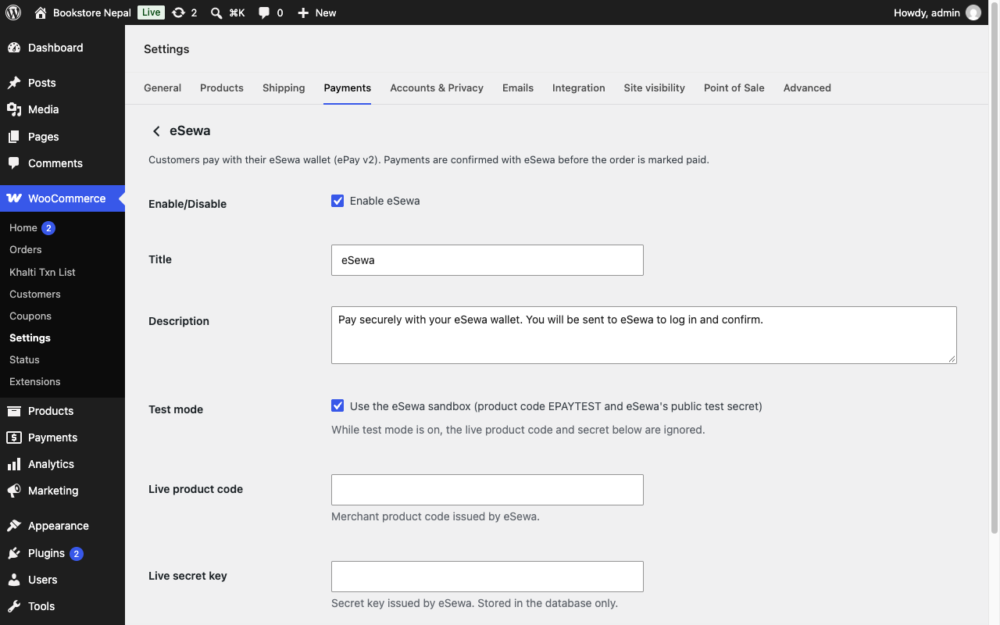

# Deployment guide

For whoever deploys and maintains the site. The repo holds only our custom plugin and theme; WordPress core, WooCommerce and third-party plugins are installed on the server.

## 1. Hosting requirements

- PHP 8.1 or newer (8.3 recommended), with the usual WordPress extensions (curl, mbstring, xml, zip, gd or imagick, intl).
- MySQL 8 or MariaDB 10.6+.
- SSL certificate (HTTPS) on the final domain. eSewa and Khalti both require it.
- WP-CLI on the server (used for setup).
- At least 256 MB PHP memory limit. If WP-CLI runs out of memory, run it as `php -d memory_limit=512M $(which wp) ...`.
- Outgoing email that works (SMTP or the host's mail). Order and low-stock emails depend on it.
- Shell or SFTP access, and a daily off-site backup option (see section 5).

## 2. Deploy steps

Run WP-CLI commands from the WordPress directory, or pass `--path=`.

1. Create the database and user, then install WordPress with the client's domain:
   ```bash
   wp core download
   wp config create --dbname=... --dbuser=... --dbpass=... --dbhost=...
   wp core install --url=https://CLIENT-DOMAIN --title="SHOP NAME" --admin_user=... --admin_email=... --prompt=admin_password
   ```
   Use a strong, non-default admin username and password.
2. Install WooCommerce:
   ```bash
   wp plugin install woocommerce --activate
   ```
3. Install the Khalti plugin, but leave it inactive for now (see "Khalti status" below):
   ```bash
   wp plugin install integrate-khalti-in-wc-store
   ```
4. Copy this repo's plugin and theme to the server:
   - `plugins/bookstore-nepal-core/` to `wp-content/plugins/bookstore-nepal-core/`
   - `themes/bookstore-nepal/` to `wp-content/themes/bookstore-nepal/`

   The theme is a child theme of Twenty Twenty-Five, so the parent theme must be installed too: `wp theme install twentytwentyfive`.
5. Activate and configure, using the client's real delivery rates (whole NPR):
   ```bash
   wp plugin activate bookstore-nepal-core
   wp bsn setup --valley=<npr> --rest=<npr> --free-over=<npr>
   wp theme activate bookstore-nepal
   ```
   Until the client supplies real rates, the placeholders are Valley NPR 100, Rest of Nepal NPR 200, free delivery over NPR 2,000. Running `wp bsn setup` with no flags uses these on a fresh install and leaves existing rates alone on later runs. Pass a flag to change just that rate.

   `wp bsn setup` is safe to run again. Every run sets currency to NPR, the default country to Nepal and stock management on, creates the Age group / Language / Book type attributes, the "Kathmandu Valley" and "Rest of Nepal" shipping zones and the "Track your order" page if any are missing, and switches permalinks to `/%postname%/` if they are still plain.

   The **first run only** also applies these store defaults, which the owner may later change in wp-admin: cash on delivery enabled for every delivery method, low-stock alert at 3 (out of stock at 0) emailed to the site admin address, guest checkout on, no decimals in prices, phone number required at checkout, and selling and delivering to Nepal only. Later runs leave them as the owner set them and print a line saying so. Setup records the first run in the `bsn_setup_done` option; to apply the defaults again (overwriting the owner's changes), run `wp option delete bsn_setup_done && wp bsn setup`.
6. **Rewrite rules.** `wp bsn setup` only clears the stored rewrite rules so WordPress rebuilds them on the next request. That does not write `.htaccess`. On Apache hosts run this once after setup, or open **Settings › Permalinks** in wp-admin and click **Save Changes**:
   ```bash
   wp rewrite flush --hard
   ```
   (Nginx sites need the usual WordPress `try_files` rule instead.) Skipping this can make shop and book pages return 404 errors.
7. Go live in WooCommerce: **WooCommerce › Settings › Site visibility**, set the site to **Live**. While "Coming soon" is on, visitors see an empty or blocked shop.
8. Add the real books, or import them with **Products › All Products › Import**.

### Content and branding checklist

- **Footer contact details.** The footer has placeholders such as `[CLIENT PHONE – edit in Site Editor › Footer]`, `[CLIENT WHATSAPP …]` and `[CLIENT SHOP ADDRESS …]`. Replace them in **Appearance › Editor › Patterns › Footer** (the footer is also reachable from Appearance › Editor › Templates/Parts). Search the live site for the word "CLIENT" afterwards to be sure none are left.
- **Refund and Returns Policy.** WooCommerce creates a draft page for this. Write the policy with the client, then publish it in **Pages** (it is listed as "Refund and Returns Policy" under Drafts). The "Returns & refunds" link in the footer stays hidden until that page is published.
- **Site icon and logo.** Once the client's logo exists, set the site icon in **Settings › General** (Site Icon) or **Appearance › Editor**, and add the logo to the header in the Site Editor.
- **Currency symbol.** WooCommerce shows the Nepali rupee as ₨ (for example ₨1,800). That is fine to leave. Under **WooCommerce › Settings › General › Currency options** you can only pick the currency (Nepalese rupee (₨) — NPR) and the **Currency position** (Left, Right, Left with space, Right with space). There is no setting for the symbol itself; showing "Rs" or "NPR" instead of ₨ needs a small code snippet using WooCommerce's `woocommerce_currency_symbol` filter, or a plugin.
- **Emails.** In **WooCommerce › Settings › Emails**, check the sender name and address, and add the shop logo and footer text.
- **Admin email.** Low-stock and new-order emails go to the address in **Settings › General** (Administration Email Address) and **WooCommerce › Settings › Emails**. Make sure it is monitored.

## 3. Payments: switch to live

Never commit payment keys. Enter them only in the live site's wp-admin.

### eSewa

1. Get the live **product code** and **secret key** from the client's eSewa merchant account.
2. Go to **WooCommerce › Settings › Payments** and open **eSewa**.
3. Enter **Live product code** and **Live secret key**.
   
4. **Untick Test mode** ("Use the eSewa sandbox"). While test mode is ticked, the live code and secret are ignored and the sandbox (product code `EPAYTEST`) is used, so real money is never taken.
5. Tick **Enable eSewa** and click **Save changes**.
6. Place a real low-value order with eSewa and confirm the order moves to **Processing**. Refund it in eSewa afterwards.

#### Scheduled tasks (WP-Cron / Action Scheduler)

The eSewa automatic payment check runs every 5 minutes through Action Scheduler (part of WooCommerce), as do WooCommerce's own jobs such as cancelling unpaid orders and sending deferred emails. Action Scheduler is started by WP-Cron, and WP-Cron by default only runs when someone visits the site, so on a quiet site the check can be late. On the live server:

1. Add `define( 'DISABLE_WP_CRON', true );` to `wp-config.php`.
2. Add a system cron job that runs every minute, either:
   ```bash
   * * * * * curl -fsS https://CLIENT-DOMAIN/wp-cron.php?doing_wp_cron > /dev/null
   ```
   or, with WP-CLI on the server:
   ```bash
   * * * * * cd /path/to/wordpress && wp action-scheduler run --quiet
   ```

To check it is working, open **WooCommerce › Status › Scheduled Actions**, search for `bsn_esewa_reconcile` (group `bsn`): there should be one **Pending** action due within 5 minutes, and the **Complete** list should show recent runs. From the command line: `wp action-scheduler action list --hook=bsn_esewa_reconcile`. The action is created automatically (on the next wp-admin, cron or WP-CLI request) after the plugin is activated, and removed when the plugin is deactivated. If eSewa's status API cannot be reached, a line starting "Bookstore Nepal eSewa: automatic check of order" is written to the PHP error log (or `wp-content/debug.log` when debug logging is on) and the order is checked again on the next run.

Test mode is on by default. Check this setting before launch and after any restore of a staging database onto the live site.

### Khalti status

The Khalti plugin (`integrate-khalti-in-wc-store`) has no support for WooCommerce's block checkout, which this site uses, so Khalti does not appear at checkout. It is also enabled by default when installed. **Keep Khalti disabled until this is resolved**: leave the plugin inactive, or in **WooCommerce › Settings › Payments** make sure Khalti is switched off. Do not tell the client Khalti is available.

Once a working option exists (a plugin version with block-checkout support, or a custom Khalti gateway like our eSewa one), enter the live keys from the Khalti merchant dashboard in the Khalti payment settings, turn test mode off, enable it, and repeat the real low-value order test.

### Cash on delivery

Enabled by the first `wp bsn setup` run. Later runs do not touch it, so if the owner switches it off or changes its title, it stays that way. Check it under **WooCommerce › Settings › Payments** if needed.

## 4. Final checks before launch

- Place one order each with cash on delivery to a Kathmandu Valley address and to another district. Check the delivery price, the order email and the order in **WooCommerce › Orders**.
- Place an order over NPR 2,000 (or the client's free-delivery amount) and confirm delivery is free.
- Confirm an out-of-stock book cannot be added to the cart.
- Confirm the `bsn_esewa_reconcile` scheduled action is pending and has recent completed runs (see "Scheduled tasks" in section 3).
- Confirm the site is **Live** (Site visibility), HTTPS works with no mixed-content warnings, and the footer has no `[CLIENT ...]` placeholders.
- Delete or set to draft any sample or test books and test orders.

## 5. Backups

- **Daily** automatic backups of the database and `wp-content/` (uploads, plugins, theme).
- Store copies **off-site**: a different provider or cloud storage bucket, not only on the web server. Keep at least 14 daily copies.
- Take an extra backup immediately before any update, and before the site goes live.
- Test a restore on a staging copy at least once, and after any hosting change.
- A plugin such as UpdraftPlus or the host's own backup tool is fine, as long as it can send copies off-site.

## 6. Monthly update routine

1. Take a backup (section 5).
2. On a staging copy if available, update WordPress core, WooCommerce and other plugins and the Twenty Twenty-Five parent theme (`wp core update`, `wp plugin update --all`, `wp theme update --all`). Check the site, then repeat on the live site. Update WooCommerce on its own, not in the same batch as other plugins.
3. After updating, run through the checks in section 4 (at minimum one cash on delivery order, and an eSewa order if keys are live).
4. Review **WooCommerce › Status** for warnings, and check there are no PHP errors in the server log.
5. Check that low-stock and order emails are still being delivered.
6. Remove unused plugins and users. Make sure admin accounts have strong passwords.
7. Deploy any new version of `bookstore-nepal-core` or `bookstore-nepal` by copying the updated folders from the repo, then re-run `wp bsn setup` (without rate flags, so rates are untouched; the owner's payment, stock, checkout and country settings are also left alone) and `wp rewrite flush --hard` on Apache.
